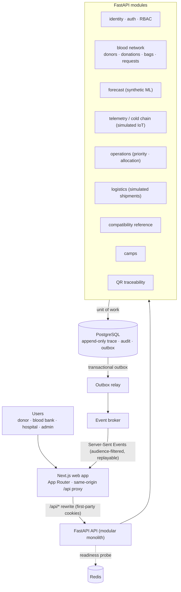
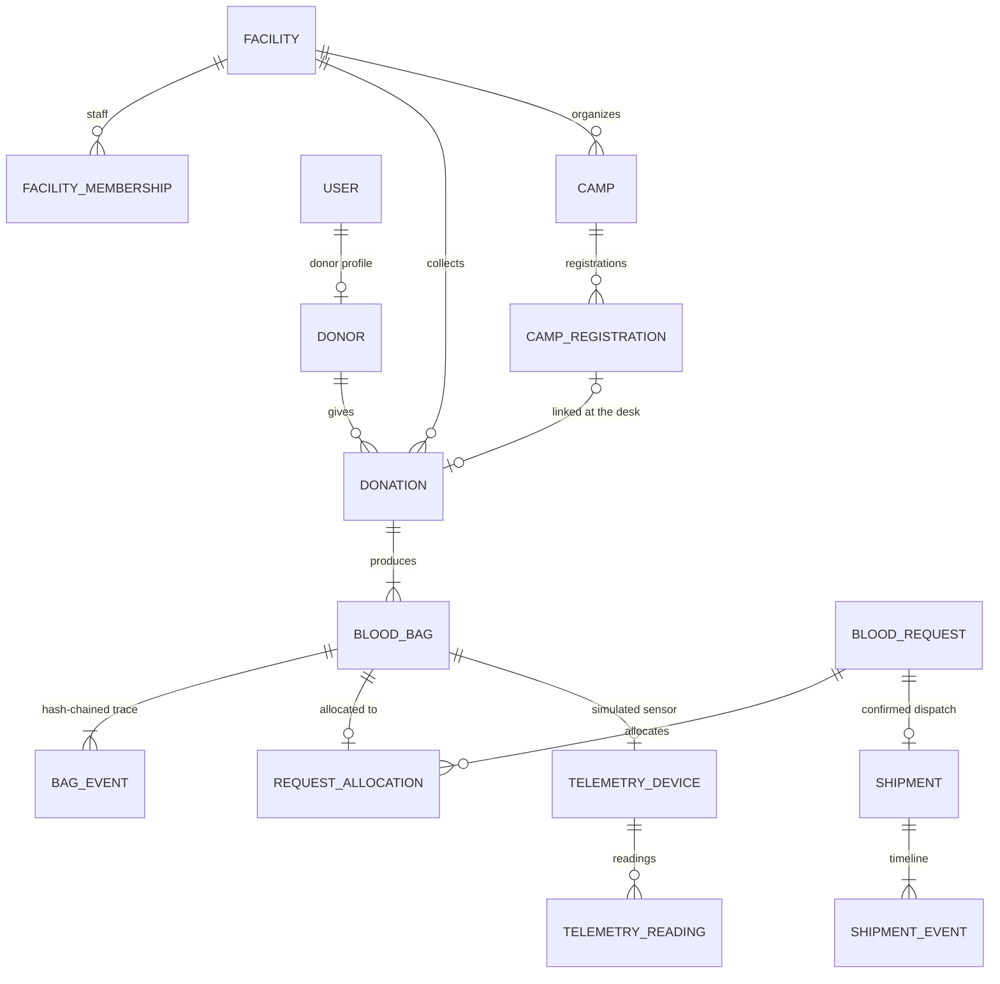

# VEYRA

**An end-to-end blood supply network platform for traceable, cold-chain-aware and operationally intelligent blood logistics.**

[Live demo](https://veyra-web-sigma.vercel.app) · [Deployment](docs/deployment.md) · [Architecture](docs/architecture/phase0-architecture.md) · [Phase reports](docs/phase-reports/) · [Disclosures](docs/demo-disclosures.md) · MIT License

> **Prototype status.** VEYRA is a final-year engineering prototype, not a certified medical system. Every simulated or demo component is labelled in both the API and the UI (see [Real vs simulated](#28-prototype--simulation-disclosures)). VEYRA does **not** provide clinical decision support and makes no claim of real-world medical validation.

---

## 1. Project Overview

VEYRA connects **donors, blood banks, hospitals and administrators** in one traceable network. A unit of blood is followed from the donation camp where the donor registers to the hospital that receives it:

- It is collected at the desk and labelled with a QR code.
- It is kept in scoped inventory and watched by a (simulated) cold-chain sensor.
- It is prioritised against emergency requests.
- It is dispatched only after a person confirms, then carried through a (simulated) shipment with checkpoints, delays and ETAs.
- It is received by the hospital.

Every step is appended to the bag's **SHA-256 hash-chained, append-only trace**.

The system is a FastAPI modular monolith with a Next.js front end, PostgreSQL persistence, a transactional outbox feeding Server-Sent Events, and strict permission + facility-scope RBAC. It was built phase by phase (Phase 0–8), and each phase ended with a real Windows bootstrap run. The final gate was **41/41 steps**; logs are in [`docs/phase-reports/`](docs/phase-reports/).

## 2. Why VEYRA

Blood is perishable, and each component has a different shelf life and storage range. Shortages are local and time-critical, and custody gaps are where units get lost or wasted. VEYRA explores what a network that treats every unit as a traceable, temperature-aware asset looks like:

- **Visibility:** hospitals see banded network availability (never exact stock), and banks see their own inventory with expiry warnings.
- **Integrity:** the custody trail is tamper-evident. An edited, removed or reordered event breaks the chain.
- **Responsiveness:** emergency requests are prioritised with explainable reasons, and dispatch is first-expiry-first-out with a cold-chain-aware ranking.
- **Human control:** nothing is dispatched, received or discarded automatically. People confirm every consequential action.

## 3. Core Features

| Area | What is implemented |
|---|---|
| Identity & access | Donor self-registration (demo verification), staff invitations, Argon2id + pepper, short-lived JWT access tokens and rotating refresh sessions, CSRF double-submit, RBAC with facility scoping |
| Donor management | Profiles, donation history showing impact (never the recipient), minimum donation interval |
| Donations & bags | Blood-bank donation desk that creates component bags with `VYR-XXXX-XXXX` ids and QR payloads |
| Inventory | Stock by blood group × component, 72 h expiry warnings, holder-only discard |
| Requests | Hospital requests (idempotent), emergency urgency, FEFO dispatch, receipt; simulated partner banks |
| Traceability | Append-only, SHA-256 hash-chained event trail per bag, with chain verification shown in the UI |
| Real-time | Transactional outbox → relay → SSE with audience filtering and `Last-Event-ID` replay |
| Forecasting | Synthetic-data demand forecasting (transparent baseline + pure-Python gradient-boosted model, reproducible artifact) |
| Cold chain | Simulated IoT devices, per-component thresholds, excursions and recoveries recorded in the trace |
| Emergency operations | Explainable priority score/band, allocation recommendations (cold chain → FEFO), pressure vs forecast, simulated routing |
| Logistics | Simulated shipments: state machine, courier, 5 schematic checkpoints, delays and resume, ETA, human receipt |
| Compatibility | Deterministic ABO/Rh reference matrix and pair check for 5 components |
| Donation camps | Camp lifecycle, capacity-safe registrations, attendance, donation linked through the normal desk |
| QR scanning | Dependency-free QR encoder, camera scanning (BarcodeDetector) with manual fallback, scoped scan lookup |

## 4. End-to-End Workflow

```
Donor → Donation Camp → Registration → Attendance → Donation → Blood Bag → QR
      → Inventory → Compatibility Reference → Hospital Request → Priority → Allocation
      → Human-confirmed Dispatch → Shipment → Cold Chain → Checkpoints → Delay / Resume
      → Arrival → Hospital Receipt → Hash-chain Trace
```

This exact journey is automated twice:

- locally by the final bootstrap step `e2e: phase 8 …`, against real PostgreSQL + Redis in Docker;
- against the live site by [`scripts/vercel/smoke.ps1`](scripts/vercel/smoke.ps1).

## 5. Architecture



**Layering:** router → service → unit of work (SQL and in-memory implementations share one repository port). Every endpoint declares a permission, and every service applies the caller's scope (own record or own facility). Out-of-scope resources return **404**, never 403, so their existence is not confirmed.

Main domain relationships:



More detail: [`docs/architecture/phase0-architecture.md`](docs/architecture/phase0-architecture.md) (with the Phase 8 addendum) and the ADRs in [`docs/adr/`](docs/adr/).

## 6. Technology Stack

Versions below come from the lockfiles and manifests in this repository.

| Layer | Technology |
|---|---|
| Web | Next.js 16 (App Router), React 19, TypeScript 5.9 (strict), Tailwind CSS 4 |
| Web tooling | pnpm 10 workspaces, Vitest 5 + Testing Library, ESLint 9 (`eslint-config-next`) |
| API client | OpenAPI-generated types (`openapi-typescript`) + `openapi-fetch` (`packages/api-client`) |
| API | Python 3.12, FastAPI 0.141, Pydantic 2 + pydantic-settings, Uvicorn |
| Persistence | SQLAlchemy 2.1 (async) + asyncpg, Alembic migrations, PostgreSQL 16 |
| Cache / probe | Redis 7 (redis-py) |
| Security | `cryptography` (Argon2id, HKDF), PyJWT |
| Quality | pytest 9, Ruff, mypy (strict) |
| Runtime | Docker Compose locally; Vercel (Next.js + Python function) with Neon Postgres and Redis Cloud for the public demo |

## 7. Frontend

`apps/web` is a Next.js App Router application:

- Role dashboards: donor, blood bank, hospital, admin.
- The live network graph (`/network`) and bag trace (`/bags/[publicId]`).
- Shipment detail (`/shipments/[id]`), camps (`/camps`), the compatibility matrix (`/compatibility`) and the bag scanner (`/scan`).
- Every data view has loading, empty, error and retry states.
- Keyboard-accessible, labelled controls; light and dark themes; reduced-motion support; mobile layouts.
- A shared design-token package: `packages/design-tokens`.
- The browser only ever talks to the web origin. Next.js proxies `/api/*` to the API, so auth cookies stay first-party and the API URL is never exposed.

## 8. Backend

`apps/api` is a FastAPI modular monolith. Its modules live in `app/modules/`: `identity`, `donors`, `facilities`, `admin`, `donations`, `bags`, `requests`, `dashboard`, `forecast`, `telemetry`, `operations`, `logistics`, `compatibility`, `camps`, `outbox`, `audit` and `system`.

- Errors are RFC 9457 problem responses with request ids.
- Settings are typed and environment-only (`VEYRA_` prefix), with startup guards that refuse unsafe production combinations.
- Provider ports (verification, blood-bank partners) keep simulated implementations swappable.

## 9. Database

PostgreSQL uses the schemas `identity`, `network`, `trace`, `telemetry` and `audit`. The **seven reversible Alembic migrations** (`apps/api/migrations/versions/0001…0007`) are registered through `app/models_registry.py`. `alembic check` keeps the models and migrations in lockstep.

Database triggers make four tables append-only: `trace.bag_events`, `telemetry.readings`, `network.shipment_events` and `audit.audit_logs`. The bootstrap verifies a full `base → head → base → head` round-trip on a scratch database, with a schema diff.

## 10. Authentication & Security

- **Passwords:** Argon2id (memory-hard, PHC format) with a server-side **pepper** fed as the Argon2 secret, plus a password policy and login lockout.
- **Sessions:** short-lived JWT access tokens plus **rotating** opaque refresh tokens. A replayed refresh token revokes the session. Cookies are `HttpOnly`, `SameSite` and `Secure` when hosted.
- **CSRF:** double-submit token on every unsafe cookie-authenticated request. A test walks the OpenAPI schema to prove it; only the 5 pre-session auth endpoints are exempt.
- **RBAC + facility scoping:** see [section 11](#11-rbac).
- **Audit:** every state change writes an append-only audit entry, which never contains passwords, tokens or health data.
- **Request ids and safe errors:** each request gets an `x-request-id`. Unhandled errors return a generic 500 without internals, and the database engine hides bound parameters from logs.
- **Security headers:** CSP, `X-Frame-Options: DENY`, `nosniff`, Referrer-Policy and Permissions-Policy, plus HSTS when hosted.
- **Production guards:** `VEYRA_ENV=production` refuses demo verification, placeholder secrets, wildcard CORS and **every simulator**. A hosted demo also refuses weak secrets and insecure cookies, and hides API docs.
- **Privacy:** hospitals never see donor identity. SSE payloads and QR payloads carry no donor or patient data, and camp registrations store no medical data.

## 11. RBAC

Permissions follow `resource:action[:scope]` and are always paired with a service-level scope check.

| Role | Can |
|---|---|
| Donor | own profile, donation history, camp registration |
| Hospital | requests, receipt, shipments to it, scoped trace, compatibility reference, published camps |
| Blood bank | inventory, donation desk, fulfilment, recommendations, simulators for bags/shipments it holds, own camps, scoped trace |
| Admin | users, facilities, audit, network-wide views and camps |

Expected codes: anonymous **401**, wrong role **403**, unrelated facility **404**. An RBAC matrix test covers every endpoint × every role.

## 12. Blood Bag Traceability

Each bag gets a public id (`VYR-XXXX-XXXX`, Crockford base32, not the primary key) and a QR payload `veyra:bag:<id>`. Its lifecycle is `available → in_transit → received | discarded`, and only lifecycle events change it. Observation events (cold chain, shipment milestones) are chained into the same trail without changing the status.

## 13. Cold Chain / IoT (simulated)

A software simulator stands in for smart-bag devices. It uses simulated device ids, RFID, battery and readings, with per-component thresholds (normal / warning / critical). Excursions and recoveries are appended to the bag's trace, and shipments raise `cold_chain_alert` in transit. Nothing is ever auto-discarded or auto-received.

## 14. ML Demand Forecasting (synthetic)

A deterministic synthetic demand generator feeds a transparent seasonal baseline and a pure-Python gradient-boosted model, compared on a chronological split. The model artifact is versioned and reproducible: the bootstrap retrains it and compares against the committed file. See the [model card](docs/model-cards/demand-forecast.md). It is labelled **"Synthetic ML forecast — prototype"** and is not clinical guidance.

## 15. Emergency Operations

Every request gets an explainable **priority** (score, band, recommended action and structured reasons). Blood banks get **allocation recommendations**: exact-match candidates ranked by cold-chain concern, then FEFO. The operations view also shows facility pressure against the forecast and simulated routing ETAs. These are recommendations only; staff confirm dispatch.

## 16. Logistics & Shipment Tracking (simulated)

A human-confirmed dispatch creates a shipment that moves `created → pickup_pending → picked_up → in_transit ⇄ delayed → arrived → received`. Invalid moves return 409. The shipment has a fictional courier, five schematic checkpoints and a deterministic ETA that is re-planned as it progresses. Receipt is always a person's action.

## 17. Compatibility Matrix

Deterministic ABO/Rh rules for Whole Blood, PRBC, Platelets, FFP and Cryoprecipitate live in one backend service (`app/modules/compatibility/engine.py`). The UI only renders them. The page offers a donor/recipient/component checker, a filterable 8 × 8 matrix, and a Compatible / Not compatible verdict with reasons. It never approves, allocates or dispatches blood.

> **"Informational prototype reference only; final transfusion decisions require authorized clinical confirmation."**

## 18. Donation Camp Management

- **Lifecycle:** `planned → published → registration_open → ongoing → completed`, with `cancelled` possible before the camp starts. Invalid transitions return 409.
- **Management:** blood banks manage their own camps; admins manage network-wide.
- **Registration:** verified donors register and cancel. Capacity is enforced under a row lock, and duplicates are refused.
- **Attendance:** staff confirm attendance. The donation is then recorded through the **normal donation desk**, so verification and the donation interval still apply.
- **Dashboards:** stats and dashboards summarise registrations, attendance, donations and bags.

> **"Prototype camp-management workflow; donor eligibility and medical screening remain governed by authorized staff."**

## 19. QR Bag Scanning

- **Label:** a dependency-free QR encoder (byte mode, level M, verified against an independent decoder) renders printable labels.
- **Scanning:** `/scan` uses the browser's `BarcodeDetector` where available, with manual id entry as the fallback. Camera frames are decoded on the device and **never stored or uploaded**.
- **Lookup:** `GET /bags/scan` returns lifecycle, location, cold chain, shipment and hash-chain status, all within the caller's custody scope.

> **"QR is a traceability identifier, not an authentication credential or medical authorization."**

## 20. Real-time SSE events

Domain events are written to a **transactional outbox** in the same database transaction as the change. A relay publishes them to an in-process broker. `GET /api/v1/stream` streams them as Server-Sent Events, filtered by audience (facility-scoped) and replayable with `Last-Event-ID`.

Topics include:

- requests: `request.*`, `inventory.updated`, `bag.discarded`
- cold chain: `telemetry.updated`
- shipments: `shipment.*`
- operations: `routing.updated`, `forecast.pressure_changed`, `allocation.recommendation_updated`
- camps: `camp.updated`

## 21. Audit & Hash-chain traceability

Each bag event stores `prev_hash` and `row_hash = SHA-256(prev_hash ‖ canonical event fields)`. Verification recomputes the chain, so any edited, inserted, removed or reordered event marks it invalid. PostgreSQL triggers forbid `UPDATE` and `DELETE` on trace, telemetry, shipment timeline and audit tables. The chain is tamper-evident inside the database; it is not anchored on a blockchain (future work).

## 22. Screenshots / Demo

- **Live demo:** **https://veyra-web-sigma.vercel.app** (public, labelled prototype demo; see [section 27](#27-production-deployment)).
- The landing page, sign-in, donor registration and `/disclosures` are public.
- Operational pages require an account. Donors can self-register with demo verification. Staff demo accounts on the live site use a private password that is **not** published in this repository.

No screenshots are committed to the repository. Use the live demo to see the UI.

## 23. Local Development

Prerequisites:

- Node.js ≥ 22 and pnpm 10 (`corepack enable`)
- Python 3.12 and [uv](https://docs.astral.sh/uv/)
- Docker Desktop (Postgres 16 + Redis 7)

```bash
cp .env.example .env              # local defaults only; never commit .env
pnpm install
(cd apps/api && uv sync)
docker compose -f infra/docker-compose.yml up -d postgres redis
(cd apps/api && uv run alembic upgrade head)
make api-dev                      # http://localhost:8000  (/docs outside production)
make web-dev                      # http://localhost:3000
```

**Windows one-shot:** `scripts\bootstrap.cmd` installs everything, runs every check and test, builds the stack in Docker, seeds demo data and runs all end-to-end journeys. It writes `docs/phase-reports/phase-0-verification.log`.

The local bootstrap seeds **DEMO ONLY** accounts (`admin@veyra.demo`, `bank@veyra.demo`, `hospital@veyra.demo`) with the documented local password `veyra-demo-console-2026`. That password exists only on your machine and is not used by the public deployment.

## 24. Environment Variables

All API settings use the `VEYRA_` prefix. See [`.env.example`](.env.example) for placeholder values.

| Variable | Purpose |
|---|---|
| `VEYRA_ENV` | `dev` · `test` · `demo` · `production` |
| `VEYRA_SECRET_KEY` | token signing; ≥ 32 random chars (required in production/hosted) |
| `VEYRA_PASSWORD_PEPPER` | optional separate Argon2 pepper |
| `VEYRA_DATABASE_URL` | `postgresql+asyncpg://…` (hosted: derived from `DATABASE_URL_UNPOOLED`) |
| `VEYRA_REDIS_URL` | Redis URL (hosted: derived from `REDIS_URL`) |
| `VEYRA_CORS_ALLOWED_ORIGINS` | JSON list of allowed web origins |
| `VEYRA_VERIFICATION_PROVIDER` | `demo_last4` (demo only) or a real OTP provider |
| `VEYRA_COOKIE_SECURE` | force secure cookies |
| `VEYRA_ENABLE_*_SIMULATOR`, `VEYRA_ENABLE_MOCK_BLOOD_BANKS` | demo components (off in production) |
| `VEYRA_API_INTERNAL_URL` (web, server-side) | where Next.js proxies `/api/*` |
| `NEXT_PUBLIC_VEYRA_ENV` (web) | shows the demo ribbon outside production |

## 25. Database Setup / Migrations

```bash
cd apps/api
uv run alembic upgrade head      # apply
uv run alembic check             # models == migrations
uv run alembic downgrade -1      # reversible
```

New tables go through a new migration. Applied migrations are never edited, and every model module is listed in `app/models_registry.py` (a test enforces it).

## 26. Testing

| Suite | Command | Final count |
|---|---|---|
| API unit + API (in-memory UoW) | `cd apps/api && uv run pytest -m "not integration"` | 670 passed |
| PostgreSQL + Redis integration | `uv run pytest -m integration` (with Docker services) | 23 passed |
| Web | `pnpm test` | 158 passed (+ api-client 9, design-tokens 5) |
| Static checks | `uv run ruff check . && uv run mypy app`, `pnpm lint && pnpm typecheck` | clean |
| Full gate | `scripts\bootstrap.cmd` (Windows) | 41/41 steps |

The integration suite covers real race conditions (the same request fulfilled once, one bag for two dispatches, concurrent receipts, the last camp seat), append-only triggers and chain validity on PostgreSQL. Plain unit tests don't cover those.

## 27. Production Deployment

The public demo runs on **Vercel**:

- **Web:** Next.js (`apps/web`) at https://veyra-web-sigma.vercel.app
- **API:** FastAPI as a Python function (`apps/api/index.py`) at https://veyra-api-five.vercel.app
- **Data:** **Neon Postgres** and **Redis Cloud** from the Vercel Marketplace

Production builds run the Alembic migrations and seed the labelled demo accounts (`apps/api/vercel_build.py`). Secrets live only in Vercel environment variables.

The runbook covers setup (`scripts/vercel/login.cmd`), releases (`scripts/vercel/deploy.cmd`) and the live smoke test (`scripts/vercel/smoke.cmd`): [`docs/deployment.md`](docs/deployment.md).

## 28. Prototype / Simulation Disclosures

| Real / implemented | Simulated / prototype |
|---|---|
| Authentication, sessions, CSRF | Demo phone verification (last 4 digits of the mobile) |
| PostgreSQL persistence, migrations | Synthetic ML demand data |
| RBAC and facility scoping | IoT telemetry (software simulator) |
| Audit log (append-only) | Courier (fictional) |
| Donations, inventory, requests, FEFO dispatch | Logistics route (schematic checkpoints, no maps/GPS) |
| Bag trace with SHA-256 hash chain | ETAs (deterministic estimates) |
| QR encoding and scoped lookup | Mock partner blood banks |
| Camp lifecycle and registrations | Compatibility content is a simplified reference |
| Compatibility rules engine | |
| Outbox → SSE real-time events | |

VEYRA does **not** claim to provide clinical decision support or real-world medical validation. There are no integrations with real hospitals, blood banks, couriers, laboratories or government systems. The canonical list is [`docs/demo-disclosures.md`](docs/demo-disclosures.md), mirrored at `/disclosures`.

## 29. Known Limitations

- The compatibility reference is simplified ABO/Rh only: no antibody screening, crossmatch, special requirements or institutional policy.
- On the serverless demo, live SSE delivery is best-effort. Missed events are replayed on reconnect, and the background telemetry ticker is off.
- Free-tier database and Redis limits apply, and the database has cold starts.
- Camera QR scanning needs a browser with `BarcodeDetector` support; manual entry works everywhere.
- The CSP still allows `'unsafe-inline'` scripts (a Next.js constraint without nonces).
- The hash chain is not anchored externally.

## 30. Future Production Work

- Real OTP verification, and clinical governance of compatibility content (versioned, reviewed rule sets, LIS/crossmatch integration).
- Real IoT and courier integrations behind the existing provider ports, and a dedicated always-on worker for the outbox relay.
- Nonce-based CSP, external anchoring of trace heads, and signed label payloads.
- Camp notifications and waitlists, and an organizer staff role.
- Observability dashboards, backups and multi-region data residency review.

## 31. License

[MIT](LICENSE) © 2026 Arpan Dey
